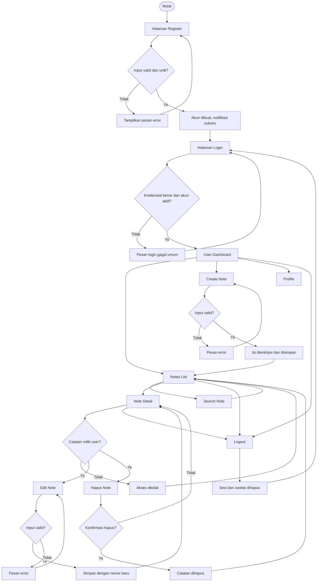
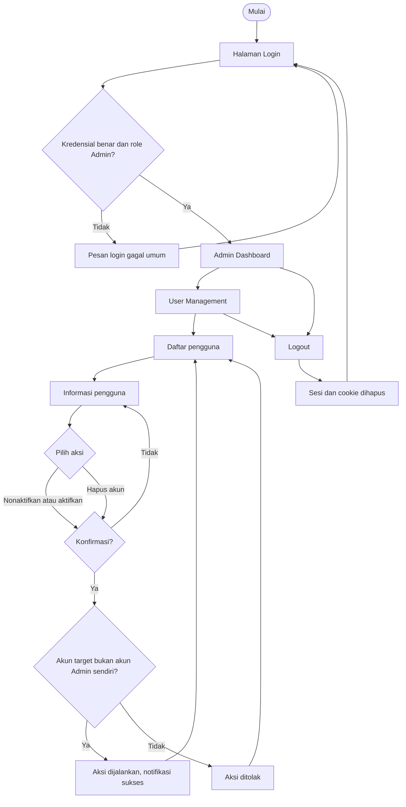
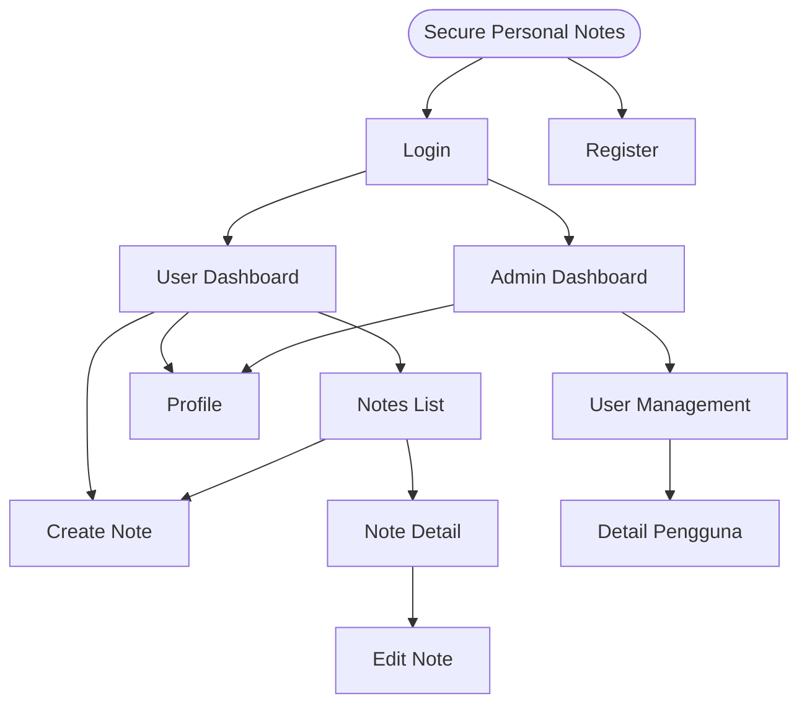
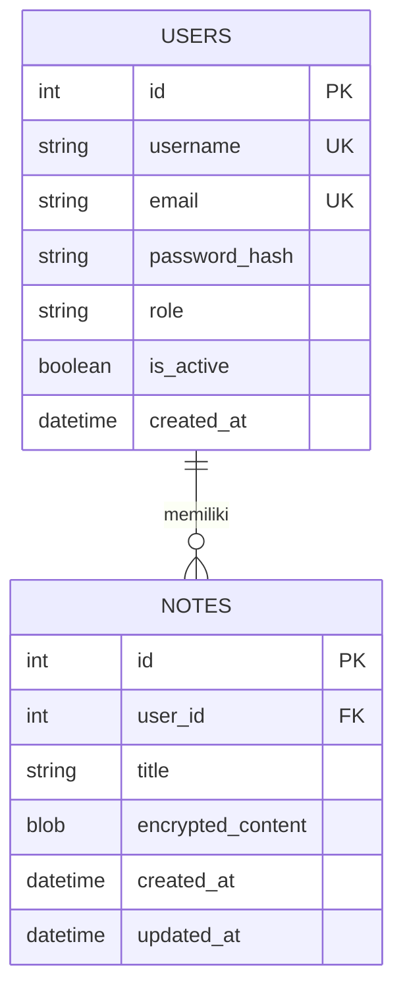

# Product Requirements Document (PRD)

## Secure Personal Notes

**Mata kuliah:** Keamanan Sistem Komputer (Tugas Individu) **Penyusun:** Wildan, Program Studi Teknik Informatika, Universitas Malikussaleh **Versi dokumen:** 1.0 (Draf awal) **Status:** Menunggu review

---

## 1. Cover / Document Information

| Atribut | Keterangan |
| --- | --- |
| Nama produk | Secure Personal Notes |
| Jenis produk | Personal Note Management System (aplikasi web) |
| Jenis dokumen | Product Requirements Document (PRD) |
| Versi | 1.0 |
| Pemilik dokumen | Shafira (Product Owner sekaligus Developer) |
| Pembaca utama | UI/UX Designer, Developer, Dosen penilai |
| Lingkungan pengembangan | VirtualBox, Ubuntu Linux |
| Bahasa dokumen | Bahasa Indonesia |

**Riwayat revisi**

| Versi | Perubahan | Status |
| --- | --- | --- |
| 1.0 | Penyusunan PRD awal | Draf |

**Daftar istilah singkat**

| Istilah | Arti |
| --- | --- |
| CIA | Confidentiality, Integrity, Availability |
| IDOR | Insecure Direct Object Reference, yaitu akses ke objek milik orang lain dengan mengubah ID |
| XSS | Cross-Site Scripting |
| SQLi | SQL Injection |
| MoSCoW | Must Have, Should Have, Could Have |

---

## 2. Executive Summary

Secure Personal Notes adalah aplikasi web untuk membuat, menyimpan, mengelola, mencari, dan menghapus catatan pribadi dengan penekanan pada keamanan informasi. Setiap pengguna memiliki akun sendiri dan hanya dapat mengakses catatan miliknya. Terdapat dua role: **Admin** (mengelola akun pengguna) dan **User** (mengelola catatan pribadi).

Produk ini merupakan tugas individu mata kuliah Keamanan Sistem Komputer. Karena itu, selain fitur catatan, produk wajib memperlihatkan penerapan **10 persyaratan keamanan**: risk assessment, password hashing, enkripsi data, HTTPS, hardening Linux, firewall, backup dan restore, pencegahan SQL Injection, pencegahan XSS, serta pencegahan IDOR dan pengamanan sesi.

Isi catatan dienkripsi sebelum disimpan ke database, kata sandi disimpan dalam bentuk hash, dan seluruh komunikasi berjalan melalui HTTPS. Skala aplikasi disesuaikan untuk lingkungan mahasiswa (satu server virtual, pengguna terbatas).

---

## 3. Product Overview

| Atribut | Keterangan |
| --- | --- |
| Nama produk | Secure Personal Notes |
| Platform | Web Application (browser desktop dan mobile) |
| Jenis | Personal Note Management System |
| Role | Admin, User |
| Konteks | Tugas individu Keamanan Sistem Komputer |

**Deskripsi.** Aplikasi memungkinkan pengguna mendaftar, masuk, lalu membuat, membaca, mengubah, mencari, dan menghapus catatan pribadi. Aplikasi menjamin pemisahan data antar pengguna dan melindungi isi catatan saat disimpan (at rest) maupun saat dikirim (in transit).

**Cakupan produk (ringkas)**

| Modul | Ringkasan |
| --- | --- |
| Authentication | Registrasi, login, logout, validasi input, pengelolaan sesi |
| Dashboard | Ringkasan jumlah catatan, catatan terbaru, info pengguna, navigasi |
| Notes Management | CRUD catatan, pencarian, detail catatan |
| User Management | Daftar dan pengelolaan akun oleh Admin |
| Security Controls | 10 persyaratan keamanan tugas |

---

## 4. Problem Statement

Catatan pribadi sering memuat informasi sensitif (rencana, kredensial, data keuangan, hal personal). Aplikasi catatan yang dibangun tanpa praktik keamanan yang baik menghadapi masalah berikut:

| No | Masalah | Dampak |
| --- | --- | --- |
| P1 | Kata sandi disimpan sebagai teks biasa atau hash lemah | Akun mudah diambil alih jika database bocor |
| P2 | Isi catatan disimpan tanpa enkripsi | Isi catatan terbaca jika file database dicuri atau backup bocor |
| P3 | Komunikasi tanpa HTTPS | Data dan cookie sesi dapat disadap |
| P4 | Input pengguna tidak divalidasi dan di-escape | Rentan SQL Injection dan XSS |
| P5 | Tidak ada pemeriksaan kepemilikan catatan | Pengguna dapat membaca catatan orang lain (IDOR) |
| P6 | Server tidak di-hardening, tanpa firewall dan backup | Layanan mudah diserang dan data bisa hilang permanen |

Produk ini bertujuan menyelesaikan masalah di atas sekaligus menjadi bukti penerapan kontrol keamanan pada tugas kuliah.

---

## 5. Product Goals and Objectives

### 5.1 Tujuan utama

Menyediakan aplikasi catatan pribadi yang **aman, sederhana, dan mudah digunakan**, serta membuktikan penerapan 10 persyaratan keamanan secara terukur dan dapat diuji.

### 5.2 Tujuan khusus

| ID | Tujuan | Ukuran keberhasilan |
| --- | --- | --- |
| G1 | Pengguna dapat mengelola catatan pribadi | Seluruh fitur CRUD dan pencarian berfungsi |
| G2 | Data antar pengguna terisolasi | Percobaan akses catatan pengguna lain selalu ditolak |
| G3 | Isi catatan terlindungi | Isi catatan di database tidak terbaca (terenkripsi) |
| G4 | Kredensial terlindungi | Tidak ada kata sandi plaintext di database |
| G5 | Komunikasi aman | Seluruh akses melalui HTTPS, HTTP dialihkan |
| G6 | Server terlindungi | Hardening, firewall, dan backup terdokumentasi dan teruji |
| G7 | Kerentanan umum tertangani | Demonstrasi versi rentan vs aman untuk SQLi dan XSS |

### 5.3 Nilai dan manfaat

- **Bagi pengguna:** catatan pribadi tersimpan privat, mudah dicari, dan tidak dapat dibaca orang lain.
- **Bagi pengembang:** pengalaman praktis menerapkan keamanan aplikasi web dan sistem.
- **Bagi penilai:** bukti pengujian yang jelas untuk setiap kontrol keamanan.

### 5.4 Batasan produk

- Skala mahasiswa: satu server virtual, jumlah pengguna terbatas.
- Hanya aplikasi web; tidak ada aplikasi mobile native.
- Catatan berupa teks (tanpa lampiran file) pada versi awal.
- Sertifikat HTTPS bersifat self-signed (peringatan browser dapat muncul).

### 5.5 Indikator keberhasilan produk

| Indikator | Target |
| --- | --- |
| Fitur Must Have terimplementasi | 100% |
| Persyaratan keamanan terpenuhi dan terbukti | 10 dari 10 |
| Percobaan IDOR berhasil | 0 |
| Kata sandi plaintext di database | 0 |
| Payload XSS dan SQLi sederhana yang berhasil pada versi aman | 0 |
| Restore backup berhasil diuji | Ya, dengan data utuh |
| Waktu muat halaman utama pada lingkungan uji | Di bawah 3 detik |

---

## 6. Target Users and User Personas

### 6.1 Target pengguna

| Segmen | Keterangan |
| --- | --- |
| Pengguna utama | Individu (mahasiswa) yang ingin menyimpan catatan pribadi secara privat |
| Pengelola | Admin yang mengelola akun pengguna |
| Penilai | Dosen yang mengevaluasi penerapan kontrol keamanan |

### 6.2 Persona Admin

| Aspek | Keterangan |
| --- | --- |
| Nama persona | Rina, Administrator Sistem |
| Profil singkat | Mahasiswa semester akhir yang menjadi pengelola aplikasi di lingkungan kampus |
| Tujuan penggunaan | Memantau dan mengelola akun pengguna agar aplikasi tetap tertib dan aman |
| Kebutuhan | Melihat daftar pengguna, informasi akun, dan menonaktifkan atau menghapus akun bermasalah |
| Permasalahan | Takut tanpa sengaja melihat data pribadi pengguna; sulit melacak akun yang mencurigakan |
| Ekspektasi | Halaman admin sederhana, aksi berisiko ada konfirmasi, dan admin tidak bisa membaca isi catatan pengguna |

### 6.3 Persona Pengguna Biasa

| Aspek | Keterangan |
| --- | --- |
| Nama persona | Dimas, Mahasiswa |
| Profil singkat | Mahasiswa semester 5 yang mencatat ide tugas, jadwal, dan hal pribadi |
| Tujuan penggunaan | Menyimpan dan menemukan kembali catatan dengan cepat dan aman |
| Kebutuhan | Buat, ubah, hapus, dan cari catatan; akses dari laptop maupun ponsel |
| Permasalahan | Khawatir catatan terbaca orang lain; sering lupa letak catatan |
| Ekspektasi | Tampilan bersih, login aman, pencarian cepat, dan keyakinan bahwa catatannya privat |

---

## 7. User Roles and Permissions

### 7.1 Matriks hak akses fitur

Keterangan: **Y** = diizinkan, **T** = tidak diizinkan, **Milik sendiri** = hanya data miliknya.

| Fitur | Admin | User |
| --- | --- | --- |
| Registrasi | Y (membuat akun lewat form umum) | Y |
| Login dan logout | Y | Y |
| Dashboard pengguna | T | Y |
| Dashboard admin | Y | T |
| Buat catatan | T | Y (milik sendiri) |
| Lihat daftar dan detail catatan | T | Y (milik sendiri) |
| Ubah catatan | T | Y (milik sendiri) |
| Hapus catatan | T | Y (milik sendiri) |
| Cari catatan | T | Y (milik sendiri) |
| Lihat profil sendiri | Y | Y |
| Lihat daftar pengguna | Y | T |
| Lihat informasi pengguna | Y (tanpa isi catatan) | T |
| Kelola akun pengguna (nonaktifkan, hapus, reset) | Y | T |

### 7.2 Matriks data per role (CRUD)

| Data | Aksi | Admin | User |
| --- | --- | --- | --- |
| Akun pengguna (users) | Lihat | Semua akun (tanpa password\_hash) | Akun sendiri |
| Akun pengguna | Buat | Y | Y (registrasi) |
| Akun pengguna | Ubah | Status akun pengguna lain | Data profil sendiri |
| Akun pengguna | Hapus | Akun pengguna lain | T |
| Catatan (notes) | Lihat | **T** (tidak dapat melihat isi) | Milik sendiri |
| Catatan | Buat | T | Milik sendiri |
| Catatan | Ubah | T | Milik sendiri |
| Catatan | Hapus | T (kecuali ikut terhapus bersama akun, lihat aturan di bawah) | Milik sendiri |

### 7.3 Batasan akses

1. **User tidak dapat mengakses catatan pengguna lain.** Setiap permintaan baca, ubah, dan hapus catatan wajib memeriksa bahwa catatan tersebut milik pengguna yang sedang login. Pelanggaran menghasilkan respons penolakan tanpa membocorkan apakah catatan itu ada.
2. User tidak dapat membuka halaman dan fungsi admin (akses ditolak).
3. Admin tidak dapat membaca isi catatan pengguna. Admin hanya mengelola akun.
4. Admin tidak dapat melihat password\_hash maupun kata sandi pengguna.
5. Admin tidak dapat menghapus atau menonaktifkan akunnya sendiri melalui halaman manajemen pengguna.
6. Jika akun pengguna dihapus oleh Admin, seluruh catatan milik akun tersebut ikut terhapus (cascade) agar tidak ada data yatim.
7. Seluruh pengecekan hak akses dilakukan di sisi server, bukan hanya dengan menyembunyikan menu di antarmuka.

---

## 8. Functional Requirements

Prioritas menggunakan skala MoSCoW: **Must Have (M)**, **Should Have (S)**, **Could Have (C)**.

### 8.1 Modul Authentication

#### FR-AUTH-01 Registrasi

| Atribut | Keterangan |
| --- | --- |
| Feature ID | FR-AUTH-01 |
| Nama fitur | Registrasi akun |
| Deskripsi | Calon pengguna membuat akun baru melalui formulir pendaftaran |
| Tujuan | Memberi setiap pengguna akun dan ruang catatan sendiri |
| Aktor | Pengunjung (calon User) |
| Input | Username, email, password, konfirmasi password |
| Proses | Validasi input, cek keunikan username dan email, hash password, simpan akun dengan role User |
| Output | Akun terbuat; pengguna diarahkan ke halaman login dengan notifikasi sukses |
| Business rules | Username dan email unik; password minimal 8 karakter dan memuat huruf serta angka; role default User; password tidak pernah ditampilkan kembali |
| Acceptance criteria | (1) Data valid membuat akun baru. (2) Username atau email duplikat ditolak dengan pesan jelas. (3) Password dan konfirmasi harus sama. (4) Password tersimpan sebagai hash, bukan teks biasa |
| Priority | Must Have |

#### FR-AUTH-02 Login

| Atribut | Keterangan |
| --- | --- |
| Feature ID | FR-AUTH-02 |
| Nama fitur | Login |
| Deskripsi | Pengguna masuk memakai kredensial terdaftar |
| Tujuan | Memastikan hanya pemilik akun yang dapat masuk |
| Aktor | User, Admin |
| Input | Username atau email, password |
| Proses | Validasi input, cari akun, verifikasi password terhadap hash, buat sesi baru |
| Output | Sesi aktif; User diarahkan ke dashboard pengguna, Admin ke dashboard admin |
| Business rules | Pesan gagal bersifat umum ("Username atau password salah") tanpa menyebut bagian mana yang salah; sesi lama diganti saat login baru; akun nonaktif tidak dapat login |
| Acceptance criteria | (1) Kredensial benar menghasilkan sesi dan redirect sesuai role. (2) Kredensial salah ditolak dengan pesan umum. (3) Akun nonaktif ditolak. (4) Percobaan login berulang dibatasi pada level server (lihat persyaratan Linux Hardening) |
| Priority | Must Have |

#### FR-AUTH-03 Logout

| Atribut | Keterangan |
| --- | --- |
| Feature ID | FR-AUTH-03 |
| Nama fitur | Logout |
| Deskripsi | Pengguna mengakhiri sesi |
| Tujuan | Mencegah penyalahgunaan sesi, terutama di perangkat bersama |
| Aktor | User, Admin |
| Input | Aksi logout |
| Proses | Sesi dihapus total pada sisi server dan cookie sesi dihapus dari browser |
| Output | Pengguna kembali ke halaman login |
| Business rules | Setelah logout, tombol Back pada browser tidak boleh menampilkan halaman terproteksi; sesi lama tidak dapat dipakai ulang |
| Acceptance criteria | (1) Setelah logout, membuka halaman terproteksi mengarahkan ke login. (2) Cookie sesi lama tidak dapat dipakai kembali |
| Priority | Must Have |

#### FR-AUTH-04 Validasi input

| Atribut | Keterangan |
| --- | --- |
| Feature ID | FR-AUTH-04 |
| Nama fitur | Validasi input |
| Deskripsi | Seluruh input formulir divalidasi di sisi server (dan dibantu validasi sisi klien) |
| Tujuan | Mencegah data tidak valid dan input berbahaya |
| Aktor | Sistem |
| Input | Seluruh data formulir |
| Proses | Cek tipe, panjang, format, dan karakter yang diizinkan |
| Output | Data diterima atau pesan kesalahan per kolom |
| Business rules | Username 4 sampai 30 karakter (huruf, angka, garis bawah); email berformat valid; judul catatan maksimal 100 karakter; isi catatan maksimal 10.000 karakter; validasi klien tidak menggantikan validasi server |
| Acceptance criteria | (1) Input melanggar aturan ditolak dengan pesan spesifik. (2) Validasi tetap berlaku bila validasi klien dilewati |
| Priority | Must Have |

#### FR-AUTH-05 Pengelolaan sesi

| Atribut | Keterangan |
| --- | --- |
| Feature ID | FR-AUTH-05 |
| Nama fitur | Pengelolaan sesi pengguna |
| Deskripsi | Sesi dibuat saat login, dilindungi, dan berakhir saat logout atau tidak aktif |
| Tujuan | Menjaga identitas pengguna selama penggunaan secara aman |
| Aktor | Sistem |
| Input | Cookie sesi |
| Proses | Validasi sesi pada setiap permintaan ke halaman terproteksi |
| Output | Akses diizinkan atau pengguna diarahkan ke login |
| Business rules | Cookie HttpOnly, Secure, SameSite=Lax; sesi kedaluwarsa setelah 30 menit tidak aktif |
| Acceptance criteria | (1) Sesi tidak valid ditolak. (2) Cookie memiliki atribut yang ditentukan. (3) Sesi berakhir setelah batas tidak aktif |
| Priority | Must Have |

### 8.2 Modul Dashboard

#### FR-DASH-01 Dashboard pengguna

| Atribut | Keterangan |
| --- | --- |
| Feature ID | FR-DASH-01 |
| Nama fitur | Dashboard pengguna |
| Deskripsi | Halaman awal setelah login yang memuat ringkasan |
| Tujuan | Memberi gambaran cepat dan akses ke fitur utama |
| Aktor | User |
| Input | Sesi login |
| Proses | Hitung total catatan milik pengguna, ambil 5 catatan terbaru, ambil info akun |
| Output | Kartu jumlah catatan, daftar 5 catatan terbaru (judul dan tanggal), nama pengguna, menu navigasi |
| Business rules | Hanya data milik pengguna yang tampil; isi catatan tidak ditampilkan penuh di daftar, hanya judul dan tanggal |
| Acceptance criteria | (1) Jumlah catatan sesuai data. (2) Catatan terbaru terurut dari yang terbaru. (3) Kondisi kosong menampilkan empty state |
| Priority | Must Have |

#### FR-DASH-02 Dashboard admin

| Atribut | Keterangan |
| --- | --- |
| Feature ID | FR-DASH-02 |
| Nama fitur | Dashboard admin |
| Deskripsi | Ringkasan jumlah akun dan akses ke manajemen pengguna |
| Tujuan | Memberi Admin gambaran kondisi akun |
| Aktor | Admin |
| Input | Sesi login Admin |
| Proses | Hitung total pengguna dan pengguna baru terbaru |
| Output | Jumlah pengguna, daftar pengguna terbaru, navigasi admin |
| Business rules | Tidak menampilkan isi catatan maupun jumlah catatan per pengguna yang mengungkap konten |
| Acceptance criteria | (1) User biasa yang membuka URL ini ditolak. (2) Angka sesuai data |
| Priority | Should Have |

### 8.3 Modul Notes Management

#### FR-NOTE-01 Create note

| Atribut | Keterangan |
| --- | --- |
| Feature ID | FR-NOTE-01 |
| Nama fitur | Membuat catatan |
| Deskripsi | User menulis catatan baru |
| Tujuan | Menyimpan informasi pribadi dengan aman |
| Aktor | User |
| Input | Judul, isi catatan |
| Proses | Validasi, enkripsi isi catatan, simpan dengan kepemilikan user yang sedang login |
| Output | Catatan tersimpan; notifikasi sukses; diarahkan ke daftar atau detail catatan |
| Business rules | Judul wajib; isi wajib; isi dienkripsi sebelum disimpan; pemilik ditentukan dari sesi, bukan dari input formulir |
| Acceptance criteria | (1) Catatan valid tersimpan dan muncul di daftar. (2) Isi catatan di database tidak terbaca. (3) Pemilik selalu sama dengan user yang login |
| Priority | Must Have |

#### FR-NOTE-02 Read note (daftar)

| Atribut | Keterangan |
| --- | --- |
| Feature ID | FR-NOTE-02 |
| Nama fitur | Melihat daftar catatan |
| Deskripsi | Menampilkan seluruh catatan milik pengguna |
| Tujuan | Memudahkan menemukan dan memilih catatan |
| Aktor | User |
| Input | Sesi login, opsional nomor halaman |
| Proses | Ambil catatan milik user, urutkan dari terbaru |
| Output | Daftar judul, cuplikan singkat, dan tanggal ubah |
| Business rules | Hanya catatan milik user; daftar dipaginasi (10 per halaman) |
| Acceptance criteria | (1) Catatan pengguna lain tidak pernah muncul. (2) Pagination berfungsi |
| Priority | Must Have |

#### FR-NOTE-03 Detail catatan

| Atribut | Keterangan |
| --- | --- |
| Feature ID | FR-NOTE-03 |
| Nama fitur | Melihat detail catatan |
| Deskripsi | Menampilkan isi lengkap satu catatan |
| Tujuan | Membaca catatan secara utuh |
| Aktor | User |
| Input | ID catatan |
| Proses | Periksa kepemilikan, ambil data, dekripsi isi |
| Output | Judul, isi, tanggal dibuat dan diubah |
| Business rules | Jika catatan bukan milik user atau tidak ada, tampilkan respons penolakan yang sama; isi ditampilkan dalam bentuk ter-escape |
| Acceptance criteria | (1) Membuka ID catatan milik orang lain ditolak. (2) Karakter HTML pada isi tampil sebagai teks, bukan dieksekusi |
| Priority | Must Have |

#### FR-NOTE-04 Update note

| Atribut | Keterangan |
| --- | --- |
| Feature ID | FR-NOTE-04 |
| Nama fitur | Mengubah catatan |
| Deskripsi | User mengedit judul dan isi catatan |
| Tujuan | Menjaga catatan tetap mutakhir |
| Aktor | User |
| Input | ID catatan, judul baru, isi baru |
| Proses | Periksa kepemilikan, validasi, enkripsi ulang isi dengan nonce baru, perbarui updated\_at |
| Output | Catatan diperbarui; notifikasi sukses |
| Business rules | Hanya pemilik yang dapat mengubah; nonce selalu baru pada setiap penyimpanan |
| Acceptance criteria | (1) Perubahan tampil pada detail. (2) Upaya ubah catatan orang lain ditolak. (3) updated\_at berubah |
| Priority | Must Have |

#### FR-NOTE-05 Delete note

| Atribut | Keterangan |
| --- | --- |
| Feature ID | FR-NOTE-05 |
| Nama fitur | Menghapus catatan |
| Deskripsi | User menghapus catatan miliknya |
| Tujuan | Memberi kendali penuh atas data pribadi |
| Aktor | User |
| Input | ID catatan, konfirmasi |
| Proses | Tampilkan modal konfirmasi, periksa kepemilikan, hapus catatan |
| Output | Catatan hilang dari daftar; notifikasi sukses |
| Business rules | Penghapusan memakai metode POST (bukan tautan GET); wajib konfirmasi; penghapusan permanen |
| Acceptance criteria | (1) Tanpa konfirmasi tidak ada penghapusan. (2) Upaya hapus catatan orang lain ditolak. (3) Catatan tidak muncul lagi setelah dihapus |
| Priority | Must Have |

#### FR-NOTE-06 Search note

| Atribut | Keterangan |
| --- | --- |
| Feature ID | FR-NOTE-06 |
| Nama fitur | Mencari catatan |
| Deskripsi | Pencarian catatan berdasarkan kata kunci pada judul |
| Tujuan | Menemukan catatan dengan cepat |
| Aktor | User |
| Input | Kata kunci |
| Proses | Cari pada judul catatan milik user (hanya catatan milik sendiri) |
| Output | Daftar catatan yang cocok atau empty state "tidak ditemukan" |
| Business rules | Pencarian hanya pada judul, karena isi catatan terenkripsi; pencarian tidak peka huruf besar-kecil; kata kunci diperlakukan sebagai data, bukan perintah |
| Acceptance criteria | (1) Hasil hanya dari catatan milik user. (2) Input seperti tanda kutip atau karakter khusus tidak merusak pencarian. (3) Tanpa hasil tampil empty state |
| Priority | Must Have |

### 8.4 Modul User Management

#### FR-USER-01 Daftar pengguna

| Atribut | Keterangan |
| --- | --- |
| Feature ID | FR-USER-01 |
| Nama fitur | Melihat daftar pengguna |
| Deskripsi | Admin melihat seluruh akun terdaftar |
| Tujuan | Memantau akun |
| Aktor | Admin |
| Input | Sesi Admin, opsional pencarian username |
| Proses | Ambil daftar akun tanpa data sensitif |
| Output | Tabel id, username, email, role, status, tanggal daftar |
| Business rules | password\_hash dan isi catatan tidak pernah ditampilkan |
| Acceptance criteria | (1) Hanya Admin dapat mengakses. (2) Kolom sensitif tidak tampil |
| Priority | Must Have |

#### FR-USER-02 Informasi pengguna

| Atribut | Keterangan |
| --- | --- |
| Feature ID | FR-USER-02 |
| Nama fitur | Melihat informasi pengguna |
| Deskripsi | Admin melihat detail satu akun |
| Tujuan | Mendukung keputusan pengelolaan akun |
| Aktor | Admin |
| Input | ID pengguna |
| Proses | Ambil data akun non-sensitif |
| Output | Username, email, role, status, tanggal daftar |
| Business rules | Tidak menampilkan isi catatan |
| Acceptance criteria | Detail tampil untuk Admin; ditolak untuk User |
| Priority | Should Have |

#### FR-USER-03 Kelola akun sesuai hak akses Admin

| Atribut | Keterangan |
| --- | --- |
| Feature ID | FR-USER-03 |
| Nama fitur | Mengelola akun pengguna |
| Deskripsi | Admin dapat menonaktifkan, mengaktifkan, atau menghapus akun User |
| Tujuan | Menjaga ketertiban akun |
| Aktor | Admin |
| Input | ID pengguna, aksi, konfirmasi |
| Proses | Validasi hak akses, konfirmasi, ubah status atau hapus akun |
| Output | Status akun berubah atau akun terhapus; notifikasi |
| Business rules | Admin tidak dapat mengelola akunnya sendiri; aksi berisiko memerlukan konfirmasi; penghapusan akun menghapus catatan terkait |
| Acceptance criteria | (1) Akun nonaktif tidak dapat login. (2) User biasa tidak dapat menjalankan aksi ini. (3) Admin tidak dapat menghapus dirinya sendiri |
| Priority | Must Have (nonaktifkan dan hapus); Could Have (reset password) |

#### FR-PROF-01 Profil

| Atribut | Keterangan |
| --- | --- |
| Feature ID | FR-PROF-01 |
| Nama fitur | Halaman profil |
| Deskripsi | Pengguna melihat informasi akunnya dan dapat mengganti password |
| Tujuan | Memberi kendali atas akun sendiri |
| Aktor | User, Admin |
| Input | Password lama, password baru |
| Proses | Verifikasi password lama, validasi password baru, simpan hash baru |
| Output | Notifikasi berhasil atau gagal |
| Business rules | Password baru mengikuti aturan yang sama dengan registrasi |
| Acceptance criteria | Password lama salah ditolak; password baru tersimpan sebagai hash |
| Priority | Should Have |

---

## 9. User Stories

Format: *As a \[user\], I want \[functionality\], so that \[benefit\].*

### 9.1 Authentication

| ID | User Story | Acceptance Criteria |
| --- | --- | --- |
| US-AUTH-01 | As a pengunjung, I want mendaftar akun, so that saya memiliki ruang catatan pribadi. | (1) Form menerima data valid dan membuat akun. (2) Username atau email yang sudah ada ditolak. (3) Password tersimpan sebagai hash. |
| US-AUTH-02 | As a user, I want login dengan akun saya, so that hanya saya yang dapat membuka catatan saya. | (1) Kredensial benar membuka dashboard. (2) Kredensial salah menampilkan pesan umum. (3) Akun nonaktif ditolak. |
| US-AUTH-03 | As a user, I want logout, so that sesi saya berakhir di perangkat bersama. | (1) Sesi dan cookie dihapus. (2) Halaman terproteksi tidak dapat dibuka lagi tanpa login. |
| US-AUTH-04 | As a user, I want mendapat pesan kesalahan yang jelas pada form, so that saya tahu cara memperbaiki input. | (1) Pesan muncul per kolom. (2) Pesan tidak membocorkan detail teknis sistem. |

### 9.2 Dashboard

| ID | User Story | Acceptance Criteria |
| --- | --- | --- |
| US-DASH-01 | As a user, I want melihat jumlah catatan saya, so that saya tahu ringkasan data saya. | Jumlah sesuai dengan catatan milik user. |
| US-DASH-02 | As a user, I want melihat catatan terbaru di dashboard, so that saya dapat melanjutkan pekerjaan dengan cepat. | Maksimal 5 catatan terbaru, terurut dari yang terbaru, hanya milik user. |
| US-DASH-03 | As an admin, I want melihat ringkasan jumlah pengguna, so that saya memantau kondisi akun. | Angka sesuai data; halaman hanya dapat dibuka oleh Admin. |

### 9.3 Notes Management

| ID | User Story | Acceptance Criteria |
| --- | --- | --- |
| US-NOTE-01 | As a user, I want membuat catatan, so that informasi penting saya tersimpan. | Catatan valid tersimpan dan isinya terenkripsi di database. |
| US-NOTE-02 | As a user, I want melihat daftar dan detail catatan, so that saya dapat membaca kembali isinya. | Hanya catatan milik sendiri yang tampil; detail menampilkan isi yang sudah didekripsi. |
| US-NOTE-03 | As a user, I want mengubah catatan, so that isinya tetap benar. | Perubahan tersimpan dan waktu ubah diperbarui. |
| US-NOTE-04 | As a user, I want menghapus catatan, so that data yang tidak diperlukan hilang. | Ada konfirmasi sebelum hapus; catatan tidak muncul lagi. |
| US-NOTE-05 | As a user, I want mencari catatan berdasarkan judul, so that saya menemukan catatan dengan cepat. | Hasil hanya dari catatan milik sendiri; tanpa hasil tampil empty state. |

### 9.4 User Management

| ID | User Story | Acceptance Criteria |
| --- | --- | --- |
| US-USER-01 | As an admin, I want melihat daftar pengguna, so that saya mengetahui akun yang terdaftar. | Daftar tidak memuat password\_hash maupun isi catatan. |
| US-USER-02 | As an admin, I want menonaktifkan atau menghapus akun bermasalah, so that aplikasi tetap tertib. | Ada konfirmasi; akun nonaktif tidak dapat login; Admin tidak dapat menghapus dirinya sendiri. |
| US-USER-03 | As a user, I want mengganti password saya, so that akun tetap aman. | Password lama diverifikasi; password baru tersimpan sebagai hash. |

### 9.5 Security

| ID | User Story | Acceptance Criteria |
| --- | --- | --- |
| US-SEC-01 | As a user, I want catatan saya tidak dapat dibuka pengguna lain, so that privasi saya terjaga. | Akses ke ID catatan milik orang lain ditolak pada baca, ubah, dan hapus. |
| US-SEC-02 | As a user, I want isi catatan terenkripsi, so that isinya aman walaupun database bocor. | Isi di database berupa data terenkripsi, bukan teks asli. |
| US-SEC-03 | As a user, I want koneksi saya terenkripsi, so that data tidak dapat disadap. | Akses lewat HTTPS; HTTP dialihkan ke HTTPS. |
| US-SEC-04 | As a user, I want input berbahaya tidak dieksekusi, so that akun dan browser saya aman. | Payload XSS tampil sebagai teks; payload SQLi tidak mengubah query. |
| US-SEC-05 | As an admin, I want server dilindungi firewall dan memiliki backup terenkripsi, so that layanan tahan serangan dan data dapat dipulihkan. | Hanya port yang diperlukan terbuka; restore backup berhasil diuji. |
| US-SEC-06 | As a developer, I want ada dokumen risk assessment, so that pilihan kontrol keamanan memiliki dasar. | Minimal lima aset dengan ancaman, kelemahan, dampak, aspek CIA, dan kontrol. |

---

## 10. User Flow

### 10.1 Alur pengguna (User)

Urutan: registrasi, login, masuk dashboard, membuat, melihat, mengedit, menghapus, mencari catatan, lalu logout.

### 10.2 Alur khusus Admin

### 10.3 Penjelasan langkah

| No | Alur | Langkah singkat | Hasil |
| --- | --- | --- | --- |
| 1 | Registrasi | Isi form, validasi, hash password, simpan akun | Akun siap, diarahkan ke login |
| 2 | Login | Isi kredensial, verifikasi, buat sesi | Masuk dashboard sesuai role |
| 3 | Dashboard | Lihat ringkasan dan navigasi | Akses ke fitur |
| 4 | Membuat catatan | Isi judul dan isi, validasi, enkripsi, simpan | Catatan muncul di daftar |
| 5 | Melihat catatan | Buka daftar lalu detail, cek kepemilikan, dekripsi | Isi tampil ter-escape |
| 6 | Mengedit catatan | Ubah isi, validasi, enkripsi ulang | Catatan diperbarui |
| 7 | Menghapus catatan | Klik hapus, konfirmasi, hapus | Catatan hilang |
| 8 | Mencari catatan | Masukkan kata kunci judul | Daftar hasil atau empty state |
| 9 | Logout | Klik logout | Sesi berakhir, kembali ke login |

---

## 11. Information Architecture

### 11.1 Sitemap

### 11.2 Daftar halaman

| Halaman | URL (rencana) | Akses | Tujuan | Tautan ke |
| --- | --- | --- | --- | --- |
| Login | /login | Publik | Masuk ke aplikasi | Register, Dashboard |
| Register | /register | Publik | Membuat akun | Login |
| User Dashboard | /dashboard | User | Ringkasan dan navigasi | Notes List, Create Note, Profile |
| Notes List | /notes | User | Daftar dan pencarian catatan | Note Detail, Create Note |
| Create Note | /notes/new | User | Membuat catatan | Notes List |
| Note Detail | /notes/{id} | User (pemilik) | Membaca catatan | Edit Note, hapus |
| Edit Note | /notes/{id}/edit | User (pemilik) | Mengubah catatan | Note Detail |
| Profile | /profile | User, Admin | Info akun dan ganti password | Dashboard |
| Admin Dashboard | /admin | Admin | Ringkasan pengguna | User Management |
| User Management | /admin/users | Admin | Kelola akun | Detail pengguna |

Catatan: pola URL di atas bersifat rencana awal dan dapat disesuaikan pada tahap desain.

### 11.3 Navigasi

| Role | Menu utama |
| --- | --- |
| User | Dashboard, Catatan, Buat Catatan, Profil, Logout |
| Admin | Dashboard Admin, Manajemen Pengguna, Profil, Logout |

---

## 12. UI/UX Requirements

### 12.1 Karakter desain

Modern, minimalis, clean, profesional, responsive, dan user-friendly. Desain tidak boleh terlalu kompleks dan memakai komponen standar Bootstrap sebagai dasar.

### 12.2 Spesifikasi per halaman

| Halaman | Layout | Elemen utama | Catatan UI/UX |
| --- | --- | --- | --- |
| Login | Satu kartu di tengah layar | Field username/email, password, tombol Login, tautan Register | Pesan error di atas form; password dapat ditampilkan atau disembunyikan |
| Register | Satu kartu di tengah layar | Username, email, password, konfirmasi, tombol Daftar | Petunjuk aturan password di bawah field |
| User Dashboard | Sidebar kiri, header atas, konten utama | Kartu jumlah catatan, daftar 5 catatan terbaru, tombol Buat Catatan | Empty state bila belum ada catatan |
| Notes List | Sidebar, header, area daftar | Kolom pencarian, kartu atau baris catatan, pagination | Judul, cuplikan, tanggal ubah; empty state bila tidak ada hasil |
| Create Note | Form satu kolom | Judul, area teks isi, tombol Simpan dan Batal | Penghitung karakter; validasi tampil per field |
| Note Detail | Kartu konten | Judul, isi, tanggal, tombol Edit dan Hapus | Hapus membuka modal konfirmasi |
| Edit Note | Form satu kolom | Judul dan isi terisi, tombol Simpan dan Batal | Peringatan bila meninggalkan halaman tanpa menyimpan (Could Have) |
| Profile | Kartu info dan form | Username, email, role, form ganti password | Email dan username hanya tampil |
| Admin Dashboard | Sidebar admin, header | Kartu total pengguna, pengguna terbaru | Tidak ada data catatan pengguna |
| User Management | Tabel penuh | Tabel pengguna, pencarian, tombol aksi | Aksi hapus dan nonaktif memakai modal konfirmasi |

### 12.3 Komponen

| Komponen | Spesifikasi |
| --- | --- |
| Layout | Sidebar tetap di desktop; pada layar kecil sidebar menjadi menu hamburger |
| Navigation | Menu aktif ditandai; Logout selalu terlihat |
| Header | Judul halaman, nama pengguna, tombol Logout |
| Cards | Sudut membulat, bayangan tipis, satu informasi utama per kartu |
| Form | Label di atas field, placeholder bersifat pendukung, pesan error merah di bawah field, tombol Submit dinonaktifkan sementara saat proses |
| Button | Primer (aksi utama), sekunder (batal), bahaya merah (hapus); satu tombol primer per area |
| Modal | Dipakai untuk konfirmasi hapus dan nonaktifkan; judul jelas, tombol Batal dan Konfirmasi |
| Empty state | Ikon sederhana, teks penjelas, dan satu tombol aksi (contoh: Buat Catatan Pertama) |
| Error state | Pesan ramah tanpa detail teknis; halaman khusus untuk 403, 404, dan 500 |
| Success notification | Toast atau alert hijau yang hilang sendiri setelah beberapa detik |

### 12.4 Rekomendasi design system

| Aspek | Rekomendasi |
| --- | --- |
| Color palette | Primer biru (#2563EB), sekunder abu-abu (#64748B), latar (#F8FAFC), teks (#0F172A), sukses (#16A34A), peringatan (#D97706), bahaya (#DC2626) |
| Typography | Satu keluarga font sans-serif (misalnya Inter atau system font); judul 24 sampai 32 px, subjudul 18 sampai 20 px, teks 16 px, teks kecil 14 px |
| Spacing | Skala kelipatan 8 px (8, 16, 24, 32) |
| Border radius | 8 px untuk kartu dan tombol, 12 px untuk modal |
| Component style | Berbasis komponen Bootstrap dengan penyesuaian warna dan radius; bayangan tipis; tanpa gradasi |
| Aksesibilitas | Kontras teks yang memadai, fokus keyboard terlihat, label pada setiap field |

---

## 13. Data Requirements

### 13.1 Entitas Users

| Atribut | Tipe data | Kunci | Fungsi | Aturan validasi | Sensitif | Dienkripsi |
| --- | --- | --- | --- | --- | --- | --- |
| id | Integer | PK | Identitas unik akun | Otomatis, unik | Tidak | Tidak |
| username | Teks (maks. 30) | Unik | Nama login dan tampilan | 4 sampai 30 karakter; huruf, angka, garis bawah; unik | Rendah | Tidak |
| email | Teks (maks. 120) | Unik | Kontak dan alternatif login | Format email valid; unik | Ya (data pribadi) | Tidak (dilindungi akses dan HTTPS) |
| password\_hash | Teks | - | Hasil hash bcrypt dari password | Tidak pernah ditampilkan atau dicatat dalam log | **Sangat sensitif** | Tidak perlu (sudah berupa hash satu arah dengan salt) |
| role | Teks | - | Menentukan hak akses (admin atau user) | Hanya nilai admin atau user; default user | Rendah | Tidak |
| is\_active | Boolean | - | Status akun aktif atau nonaktif | Default aktif | Tidak | Tidak |
| created\_at | Datetime | - | Waktu pendaftaran | Diisi otomatis | Tidak | Tidak |

Catatan: kolom `is_active` ditambahkan di luar daftar minimal agar fitur menonaktifkan akun (FR-USER-03) dapat dipenuhi.

### 13.2 Entitas Notes

| Atribut | Tipe data | Kunci | Fungsi | Aturan validasi | Sensitif | Dienkripsi |
| --- | --- | --- | --- | --- | --- | --- |
| id | Integer | PK | Identitas unik catatan | Otomatis, unik | Tidak | Tidak |
| user\_id | Integer | FK ke Users.id | Pemilik catatan, dasar pemeriksaan kepemilikan | Wajib; harus merujuk akun yang ada; diambil dari sesi | Tidak | Tidak |
| title | Teks (maks. 100) | - | Judul catatan, dipakai untuk daftar dan pencarian | Wajib; 1 sampai 100 karakter | Sedang | Tidak (agar dapat dicari) |
| encrypted\_content | Biner atau teks terkode | - | Isi catatan dalam bentuk terenkripsi (termasuk nonce dan authentication tag) | Isi asli maksimal 10.000 karakter sebelum enkripsi | **Sangat sensitif** | **Ya, AES-256-GCM** |
| created\_at | Datetime | - | Waktu pembuatan | Otomatis | Tidak | Tidak |
| updated\_at | Datetime | - | Waktu perubahan terakhir | Diperbarui setiap kali catatan diubah | Tidak | Tidak |

Catatan: judul sengaja tidak dienkripsi supaya pencarian judul dapat berjalan. Pengguna disarankan tidak menulis informasi rahasia pada judul. Keputusan ini dicatat pada bagian Assumptions and Open Questions.

### 13.3 Relasi

| Relasi | Kardinalitas | Aturan |
| --- | --- | --- |
| Users ke Notes | Satu ke banyak (1 : N) | Satu user memiliki banyak catatan; satu catatan hanya dimiliki satu user. Jika akun dihapus, seluruh catatannya ikut terhapus. |

### 13.4 ERD

### 13.5 Klasifikasi data

| Klasifikasi | Data | Perlakuan |
| --- | --- | --- |
| Sangat sensitif | password\_hash, encrypted\_content, kunci enkripsi | Tidak pernah tampil di antarmuka atau log; kunci tidak disimpan di source code atau database |
| Sensitif | email, title | Hanya tampil kepada pemilik atau Admin (khusus data akun); dikirim lewat HTTPS |
| Umum | id, role, created\_at, updated\_at | Tampil sesuai hak akses |

---

## 14. Non-Functional Requirements

Kebutuhan berikut dibuat realistis untuk aplikasi skala mahasiswa (satu server virtual).

| ID | Kategori | Kebutuhan | Cara verifikasi |
| --- | --- | --- | --- |
| NFR-01 | Security | Seluruh kontrol pada bagian 15 diterapkan; tidak ada kata sandi plaintext; seluruh akses lewat HTTPS | Uji sesuai bukti pengujian bagian 15 |
| NFR-02 | Performance | Halaman utama dan daftar catatan termuat di bawah 3 detik pada lingkungan uji dengan sampai 100 catatan per pengguna | Pengukuran sederhana di browser |
| NFR-03 | Performance | Hash password dan enkripsi tidak membuat login atau simpan catatan terasa lambat (di bawah 2 detik) | Uji manual |
| NFR-04 | Reliability | Aplikasi menangani error tanpa crash; error tidak membuka detail teknis kepada pengguna | Uji input tidak valid dan akses ke halaman yang tidak ada |
| NFR-05 | Reliability | Layanan aplikasi berjalan otomatis setelah server dinyalakan ulang | Restart VM lalu cek layanan |
| NFR-06 | Usability | Pengguna baru dapat mendaftar, membuat, dan mencari catatan tanpa panduan tambahan | Uji coba dengan beberapa pengguna |
| NFR-07 | Usability | Tampilan responsif pada lebar layar ponsel hingga desktop | Uji dengan mode responsif browser |
| NFR-08 | Maintainability | Struktur kode rapi, konfigurasi dan rahasia dipisah dari kode, dokumentasi instalasi tersedia | Review dokumentasi |
| NFR-09 | Compatibility | Berjalan pada browser modern versi terbaru (Chrome, Firefox, Edge) | Uji pada minimal dua browser |
| NFR-10 | Availability | Target ketersediaan wajar untuk lingkungan uji; tidak ada target SLA formal | Dicatat sebagai batasan |
| NFR-11 | Data Integrity | Catatan dan akun konsisten; penghapusan akun tidak meninggalkan catatan yatim; kegagalan dekripsi terdeteksi oleh authentication tag GCM | Uji hapus akun dan uji modifikasi data terenkripsi |
| NFR-12 | Data Integrity | Hasil restore backup sama dengan data sebelum backup | Bandingkan jumlah dan isi data |

---

## 15. Security Requirements

Bagian ini mengakomodasi seluruh 10 persyaratan keamanan tugas. Setiap persyaratan menjelaskan tujuan, risiko, kebutuhan sistem, perilaku aplikasi, kriteria penerimaan, dan bukti pengujian. Dokumen ini menetapkan **apa** yang harus dicapai; pemilihan cara teknis detail ditentukan pada tahap pengembangan.

### Ringkasan pemetaan

| ID | Persyaratan | Fitur atau area terkait | Prioritas |
| --- | --- | --- | --- |
| SEC-01 | Risk Assessment | Seluruh aplikasi dan server | Must Have |
| SEC-02 | Password Hashing | FR-AUTH-01, FR-AUTH-02, FR-PROF-01 | Must Have |
| SEC-03 | Data Encryption | FR-NOTE-01, FR-NOTE-03, FR-NOTE-04 | Must Have |
| SEC-04 | HTTPS | Seluruh komunikasi | Must Have |
| SEC-05 | Linux Hardening | Server Ubuntu | Must Have |
| SEC-06 | Firewall | Server Ubuntu | Must Have |
| SEC-07 | Backup and Restore | Database dan konfigurasi | Must Have |
| SEC-08 | SQL Injection | Seluruh akses database, termasuk login dan pencarian | Must Have |
| SEC-09 | XSS | Seluruh tampilan data pengguna | Must Have |
| SEC-10 | IDOR and Session Security | FR-NOTE-03 sampai 05, FR-AUTH-03, FR-AUTH-05 | Must Have |

---

### SEC-01 Risk Assessment

| Aspek | Penjelasan |
| --- | --- |
| Tujuan keamanan | Mengidentifikasi aset, ancaman, dan kelemahan sehingga setiap kontrol keamanan memiliki alasan yang jelas |
| Risiko yang ditangani | Kontrol dipilih tanpa dasar, ada aset penting yang terlewat, prioritas keamanan tidak jelas |
| Kebutuhan sistem | Dokumen risk assessment yang memuat minimal lima aset beserta ancaman, kelemahan, dampak, aspek CIA, dan kontrol |
| Perilaku aplikasi yang diharapkan | Setiap kontrol pada SEC-02 sampai SEC-10 dapat ditelusuri ke satu risiko pada risk assessment |
| Kriteria penerimaan | (1) Minimal lima aset terdaftar. (2) Setiap aset memiliki ancaman, kelemahan, dampak, aspek CIA, dan kontrol. (3) Setiap kontrol terhubung dengan persyaratan SEC terkait |
| Bukti pengujian | Dokumen tabel risk assessment dan tabel keterhubungan risiko ke kontrol |

**Contoh awal risk assessment (dapat dikembangkan pada dokumen terpisah)**

| No | Aset | Ancaman | Kelemahan | Dampak | Prinsip CIA | Kontrol |
| --- | --- | --- | --- | --- | --- | --- |
| 1 | Isi catatan pengguna | Pencurian file database atau backup | Isi tersimpan tanpa enkripsi | Kebocoran informasi pribadi | Confidentiality | AES-256-GCM (SEC-03), backup terenkripsi (SEC-07) |
| 2 | Kredensial pengguna (password) | Pembobolan database, brute force | Hash lemah atau tanpa salt, tanpa pembatasan percobaan | Pengambilalihan akun | Confidentiality | bcrypt dengan salt (SEC-02), pembatasan percobaan login (SEC-05) |
| 3 | Sesi pengguna | Pencurian cookie, session hijacking, CSRF | Cookie tanpa atribut keamanan, logout tidak menghapus sesi | Penyalahgunaan akun | Confidentiality, Integrity | Cookie HttpOnly, Secure, SameSite=Lax; logout menyeluruh (SEC-10), HTTPS (SEC-04) |
| 4 | Database aplikasi | SQL Injection | Query dibentuk dari input mentah | Data bocor, diubah, atau dihapus | Confidentiality, Integrity, Availability | Prepared statement (SEC-08) |
| 5 | Server Ubuntu dan layanan | Akses SSH tidak sah, pemindaian port, eksploitasi layanan | Port terbuka berlebihan, SSH default, sistem tidak diperbarui | Pengambilalihan server, layanan terhenti | Confidentiality, Integrity, Availability | Hardening (SEC-05), UFW (SEC-06) |
| 6 | Data backup | Pencurian atau kerusakan file backup | Backup tidak terenkripsi, restore tidak pernah diuji | Kebocoran data atau data tidak dapat dipulihkan | Confidentiality, Availability | Backup terenkripsi, cron, uji restore (SEC-07) |
| 7 | Halaman web dan browser pengguna | XSS | Output tidak di-escape | Pencurian sesi, manipulasi tampilan | Integrity, Confidentiality | Output escaping (SEC-09) |
| 8 | Catatan antar pengguna | IDOR | Tidak ada pemeriksaan kepemilikan | Pengguna membaca atau mengubah catatan orang lain | Confidentiality, Integrity | Pemeriksaan kepemilikan (SEC-10) |
| 9 | Kunci enkripsi | Kebocoran kunci lewat source code atau repositori | Kunci ditanam di kode | Seluruh catatan dapat didekripsi | Confidentiality | Kunci di luar source code dengan permission ketat (SEC-03) |

---

### SEC-02 Password Hashing (bcrypt dengan salt)

| Aspek | Penjelasan |
| --- | --- |
| Tujuan keamanan | Melindungi kredensial pengguna walaupun database bocor |
| Risiko yang ditangani | Pencurian database, serangan rainbow table, dan brute force offline |
| Kebutuhan sistem | Password disimpan hanya dalam bentuk hash bcrypt dengan salt unik per pengguna; tidak ada penyimpanan password asli di database, log, atau berkas lain |
| Perilaku aplikasi yang diharapkan | Saat registrasi dan ganti password, password diubah menjadi hash sebelum disimpan. Saat login, password yang dimasukkan dibandingkan dengan hash. Dua pengguna dengan password sama menghasilkan hash berbeda. Password tidak pernah ditampilkan kembali |
| Kriteria penerimaan | (1) Kolom password\_hash berisi hash bcrypt, bukan teks asli. (2) Hash dua akun dengan password identik berbeda. (3) Login berhasil dengan password benar dan gagal dengan password salah. (4) Tidak ada password pada log aplikasi |
| Bukti pengujian | Tangkapan layar isi tabel Users (kolom password\_hash), uji dua akun dengan password sama, uji login benar dan salah |

---

### SEC-03 Data Encryption (AES-256-GCM)

| Aspek | Penjelasan |
| --- | --- |
| Tujuan keamanan | Menjaga kerahasiaan dan keaslian isi catatan saat disimpan |
| Risiko yang ditangani | Pembacaan isi catatan dari file database atau backup yang dicuri; modifikasi data terenkripsi |
| Kebutuhan sistem | Isi catatan dienkripsi dengan AES-256-GCM; setiap enkripsi memakai nonce acak 12 byte yang berbeda; nonce dan authentication tag disimpan bersama data terenkripsi; kunci 256-bit disimpan **di luar source code dan di luar database**, dengan permission file yang membatasi akses |
| Perilaku aplikasi yang diharapkan | Isi catatan dienkripsi sebelum masuk database dan didekripsi hanya saat pemilik menampilkan catatan. Setiap penyimpanan, termasuk edit, memakai nonce baru. Data yang diubah di database terdeteksi dan gagal didekripsi tanpa menampilkan isi |
| Kriteria penerimaan | (1) Kolom encrypted\_content tidak terbaca sebagai teks asli. (2) Dua catatan berisi teks sama menghasilkan data terenkripsi berbeda. (3) Nonce 12 byte dan acak untuk setiap enkripsi. (4) Kunci tidak ada dalam source code maupun repositori. (5) Data yang dimodifikasi menghasilkan kegagalan dekripsi yang ditangani dengan aman |
| Bukti pengujian | Tangkapan layar isi kolom encrypted\_content, uji dua catatan identik, bukti lokasi kunci dan permission-nya, uji modifikasi data terenkripsi |

---

### SEC-04 HTTPS (sertifikat SSL self-signed OpenSSL)

| Aspek | Penjelasan |
| --- | --- |
| Tujuan keamanan | Mengenkripsi komunikasi antara browser dan server |
| Risiko yang ditangani | Penyadapan dan manipulasi lalu lintas (man-in-the-middle) pada password, cookie sesi, dan isi catatan |
| Kebutuhan sistem | Sertifikat SSL self-signed dibuat menggunakan OpenSSL; web server Nginx melayani aplikasi melalui HTTPS; permintaan HTTP dialihkan ke HTTPS |
| Perilaku aplikasi yang diharapkan | Seluruh halaman diakses lewat HTTPS. Browser dapat menampilkan peringatan karena sertifikat self-signed; hal ini diterima dan dijelaskan pada dokumentasi pengujian |
| Kriteria penerimaan | (1) Aplikasi dapat dibuka melalui alamat HTTPS. (2) Akses HTTP otomatis dialihkan ke HTTPS. (3) Detail sertifikat dapat ditunjukkan (penerbit, masa berlaku). (4) Cookie sesi bertanda Secure |
| Bukti pengujian | Tangkapan layar halaman HTTPS dan detail sertifikat, bukti redirect HTTP ke HTTPS, bukti pemeriksaan sertifikat lewat OpenSSL |

---

### SEC-05 Linux Hardening

| Aspek | Penjelasan |
| --- | --- |
| Tujuan keamanan | Mengurangi permukaan serangan pada server Ubuntu |
| Risiko yang ditangani | Akses tidak sah lewat akun berprivilege tinggi atau SSH, brute force, eksploitasi celah pada paket yang usang, penyalahgunaan layanan yang berjalan sebagai root |
| Kebutuhan sistem | (a) Akun admin non-root untuk administrasi. (b) Akun layanan khusus (service account) untuk menjalankan aplikasi dengan hak minimal. (c) Permission file dan folder yang ketat, terutama untuk database, kunci enkripsi, sertifikat, dan backup. (d) Pengamanan SSH: login root dinonaktifkan dan metode autentikasi diperketat. (e) Pembatasan percobaan login (misalnya melalui fail2ban atau mekanisme setara). (f) Pembaruan sistem dan paket keamanan |
| Perilaku aplikasi yang diharapkan | Aplikasi berjalan sebagai service account tanpa hak root. Administrasi dilakukan lewat akun admin non-root. Percobaan login berulang yang gagal menyebabkan pemblokiran sementara |
| Kriteria penerimaan | (1) Login SSH sebagai root ditolak. (2) Proses aplikasi tidak berjalan sebagai root. (3) File kunci dan database hanya dapat dibaca akun yang berhak. (4) Percobaan login gagal berulang diblokir. (5) Sistem diperbarui dan tidak ada pembaruan keamanan tertunda |
| Bukti pengujian | Daftar akun dan group, tangkapan layar permission file, konfigurasi dan uji penolakan SSH root, bukti pemblokiran percobaan login, hasil pembaruan sistem |

---

### SEC-06 Firewall (UFW Default Deny dan Nmap)

| Aspek | Penjelasan |
| --- | --- |
| Tujuan keamanan | Membatasi lalu lintas masuk hanya pada port yang dibutuhkan |
| Risiko yang ditangani | Port terbuka yang tidak diperlukan, pemindaian dan eksploitasi layanan |
| Kebutuhan sistem | UFW dengan kebijakan default deny untuk lalu lintas masuk; hanya port yang diperlukan dibuka (SSH dan HTTPS, serta HTTP bila dipakai untuk redirect); pemindaian Nmap dilakukan **sebelum dan sesudah** konfigurasi firewall |
| Perilaku aplikasi yang diharapkan | Aplikasi tetap dapat diakses lewat HTTPS dan administrasi tetap lewat SSH, sedangkan port lain tidak terjangkau dari luar |
| Kriteria penerimaan | (1) Status UFW aktif dengan default deny incoming. (2) Hanya port yang diizinkan terbuka. (3) Hasil Nmap sesudah konfigurasi menampilkan lebih sedikit port terbuka dibandingkan sebelumnya. (4) Aplikasi tetap berfungsi |
| Bukti pengujian | Hasil Nmap sebelum dan sesudah, status UFW, uji akses aplikasi setelah firewall aktif |

---

### SEC-07 Backup and Restore

| Aspek | Penjelasan |
| --- | --- |
| Tujuan keamanan | Menjamin ketersediaan dan pemulihan data, sekaligus menjaga kerahasiaan backup |
| Risiko yang ditangani | Kehilangan data akibat kerusakan, penghapusan tidak sengaja, atau serangan; kebocoran data lewat file backup |
| Kebutuhan sistem | Backup otomatis terjadwal menggunakan cron; file backup dienkripsi; lokasi backup memiliki permission ketat; prosedur restore terdokumentasi dan diuji |
| Perilaku aplikasi yang diharapkan | Backup berjalan sesuai jadwal tanpa mengganggu aplikasi. Restore menghasilkan data yang sama dengan sebelum backup |
| Kriteria penerimaan | (1) Jadwal cron aktif dan menghasilkan file backup. (2) File backup tidak dapat dibuka tanpa dekripsi. (3) Restore berhasil pada lingkungan uji. (4) Jumlah dan isi data setelah restore sama dengan data asal |
| Bukti pengujian | Konfigurasi jadwal cron, daftar file backup, bukti file terenkripsi, catatan uji restore sebelum dan sesudah |

---

### SEC-08 SQL Injection

| Aspek | Penjelasan |
| --- | --- |
| Tujuan keamanan | Memastikan input pengguna selalu diperlakukan sebagai data, bukan bagian perintah database |
| Risiko yang ditangani | Login dilewati, data bocor atau dimodifikasi lewat input yang dimanipulasi (misalnya pada form login dan pencarian) |
| Kebutuhan sistem | Seluruh akses database memakai prepared statement (parameterized query); tidak ada query yang dibentuk dengan menggabungkan input mentah. Disediakan dua versi untuk demonstrasi: **versi rentan** dan **versi aman** |
| Perilaku aplikasi yang diharapkan | Pada versi aman, input seperti tanda kutip atau pola injeksi umum tidak mengubah hasil query dan hanya diperlakukan sebagai teks biasa. Versi rentan hanya dipakai untuk demonstrasi di lingkungan uji terisolasi dan tidak menjadi versi produksi |
| Kriteria penerimaan | (1) Payload injeksi pada login dan pencarian berhasil mengelabui versi rentan. (2) Payload yang sama gagal pada versi aman. (3) Tidak ada query yang dibentuk dari input mentah pada versi aman |
| Bukti pengujian | Tabel perbandingan payload dan hasil pada kedua versi, tangkapan layar hasil, dan bukti tinjauan kode bahwa versi aman memakai parameterisasi |

---

### SEC-09 XSS (Cross-Site Scripting)

| Aspek | Penjelasan |
| --- | --- |
| Tujuan keamanan | Memastikan konten buatan pengguna tidak dieksekusi sebagai kode di browser |
| Risiko yang ditangani | Pencurian sesi, pengubahan tampilan, dan aksi tidak sah atas nama pengguna lewat skrip yang disisipkan pada judul atau isi catatan |
| Kebutuhan sistem | Seluruh data yang berasal dari pengguna ditampilkan dengan output encoding atau escaping; tidak ada tampilan data pengguna yang dibiarkan mentah. Disediakan **versi rentan** dan **versi aman** untuk demonstrasi |
| Perilaku aplikasi yang diharapkan | Pada versi aman, teks seperti tag skrip tampil sebagai teks biasa dan tidak dijalankan. Versi rentan hanya untuk demonstrasi di lingkungan uji |
| Kriteria penerimaan | (1) Payload XSS pada judul dan isi catatan dieksekusi pada versi rentan. (2) Payload yang sama tampil sebagai teks pada versi aman. (3) Seluruh titik tampil data pengguna (daftar, detail, dashboard, pencarian, tabel admin) ter-escape |
| Bukti pengujian | Tabel perbandingan payload dan hasil pada kedua versi, tangkapan layar, dan daftar titik tampil data yang diperiksa |

---

### SEC-10 IDOR dan Session Security

| Aspek | Penjelasan |
| --- | --- |
| Tujuan keamanan | Memastikan pengguna hanya mengakses datanya sendiri dan sesi pengguna terlindungi |
| Risiko yang ditangani | Akses catatan pengguna lain dengan mengubah ID di alamat, pencurian cookie sesi, penyalahgunaan sesi lama setelah logout, serangan lintas situs |
| Kebutuhan sistem | (a) Setiap operasi baca, ubah, dan hapus catatan memeriksa bahwa catatan milik pengguna yang sedang login. (b) Cookie sesi memakai atribut HttpOnly, Secure, dan SameSite=Lax. (c) Logout menghapus sesi di sisi server dan cookie di browser. (d) Halaman admin memeriksa role di sisi server |
| Perilaku aplikasi yang diharapkan | Mengganti ID catatan di alamat dengan ID milik pengguna lain menghasilkan penolakan dan tidak membocorkan keberadaan catatan tersebut. Setelah logout, sesi lama tidak dapat dipakai |
| Kriteria penerimaan | (1) User A tidak dapat membaca, mengubah, atau menghapus catatan User B. (2) User biasa tidak dapat membuka halaman admin. (3) Cookie sesi memiliki atribut HttpOnly, Secure, dan SameSite=Lax. (4) Cookie lama ditolak setelah logout. (5) Tombol Back setelah logout tidak menampilkan halaman terproteksi |
| Bukti pengujian | Skenario uji IDOR dua akun dengan hasil penolakan, tangkapan layar atribut cookie pada alat pengembang browser, uji pemakaian ulang cookie setelah logout |

---

## 16. System Constraints

Teknologi berikut adalah **batasan awal** yang ditetapkan oleh ketentuan tugas, bukan keputusan arsitektur detail.

| Area | Teknologi | Peran dalam produk |
| --- | --- | --- |
| Backend | Python Flask | Logika aplikasi dan pemeriksaan hak akses |
| Database | SQLite | Penyimpanan akun dan catatan |
| Frontend | HTML, CSS, JavaScript, Bootstrap | Antarmuka responsif |
| Sistem operasi | Ubuntu Linux | Lingkungan server |
| Web server | Nginx | Melayani aplikasi dan terminasi HTTPS |
| Hash password | bcrypt | Perlindungan kredensial (SEC-02) |
| Enkripsi data | AES-GCM | Perlindungan isi catatan (SEC-03) |
| Sertifikat | OpenSSL | Pembuatan sertifikat self-signed (SEC-04) |
| Firewall | UFW | Pembatasan lalu lintas masuk (SEC-06) |
| Lingkungan uji | VirtualBox | Pengembangan dan pengujian pada Ubuntu |

**Batasan tambahan**

- Seluruh pengembangan dan pengujian dilakukan pada mesin virtual VirtualBox.
- Aplikasi dirancang untuk satu server dan jumlah pengguna terbatas.
- Sertifikat HTTPS bersifat self-signed.

---

## 17. Out of Scope

Fitur berikut tidak termasuk dalam versi awal:

| No | Fitur | Alasan |
| --- | --- | --- |
| 1 | Sinkronisasi cloud | Tidak diperlukan untuk tujuan tugas; menambah risiko dan kompleksitas |
| 2 | Kolaborasi atau berbagi catatan antar pengguna | Bertentangan dengan prinsip catatan privat |
| 3 | Aplikasi Android atau iOS | Platform hanya web |
| 4 | Integrasi pihak ketiga (login sosial, layanan eksternal) | Di luar batasan teknologi |
| 5 | Fitur AI untuk merangkum catatan | Tidak mendukung tujuan keamanan |
| 6 | Lampiran file atau gambar pada catatan | Menambah permukaan serangan (unggah file) |
| 7 | Verifikasi email, lupa password via email, dan MFA | Memerlukan layanan email dan di luar ketentuan tugas |
| 8 | Pencarian pada isi catatan | Isi terenkripsi; pencarian hanya pada judul |
| 9 | Berbagi sertifikat tepercaya (CA publik) dan penerapan ke internet publik | Sertifikat self-signed untuk lingkungan uji |

---

## 18. Assumptions and Open Questions

### 18.1 Asumsi produk

- Pengguna mengakses aplikasi dari browser modern.
- Aplikasi dipakai pada jaringan lokal atau lingkungan VirtualBox, bukan internet publik.
- Admin dibuat oleh pengembang pada saat penyiapan awal, bukan melalui form registrasi umum.
- Registrasi umum hanya menghasilkan akun dengan role User.
- Judul catatan tidak dienkripsi agar dapat dicari; isi catatan dienkripsi.

### 18.2 Batasan teknis

- Teknologi dibatasi pada daftar di bagian 16.
- SQLite cocok untuk skala kecil dan tidak ditujukan untuk banyak pengguna bersamaan.
- Peringatan browser pada sertifikat self-signed tidak dapat dihindari.

### 18.3 Ketergantungan sistem

| Ketergantungan | Dibutuhkan oleh |
| --- | --- |
| Ubuntu dan VirtualBox berjalan | Seluruh pengembangan dan pengujian |
| Nginx dan sertifikat OpenSSL | HTTPS (SEC-04) |
| Kunci enkripsi tersedia di luar source code | Enkripsi dan dekripsi catatan (SEC-03) |
| Cron aktif dan ruang penyimpanan backup | SEC-07 |
| Akses jaringan untuk pembaruan paket | SEC-05 |

### 18.4 Hal yang masih membutuhkan keputusan

Ketentuan tugas tidak menyebutkan hal-hal berikut, sehingga perlu diputuskan oleh pemilik produk:

| No | Pertanyaan | Opsi atau catatan |
| --- | --- | --- |
| Q1 | Bagaimana akun Admin pertama dibuat? | Disiapkan manual saat setup, atau lewat skrip inisialisasi |
| Q2 | Apakah Admin boleh membuat akun pengguna dari halaman manajemen? | PRD saat ini hanya mencakup lihat, nonaktifkan, dan hapus |
| Q3 | Berapa lama batas tidak aktif sesi? | Asumsi sementara 30 menit |
| Q4 | Berapa batas percobaan login gagal sebelum diblokir dan berapa lama blokirnya? | Perlu ditetapkan pada tahap hardening |
| Q5 | Seberapa sering backup otomatis dijalankan dan berapa lama backup disimpan? | Misalnya harian; perlu dikonfirmasi |
| Q6 | Algoritma dan metode enkripsi backup yang dipakai? | Perlu dipilih pada tahap pengembangan |
| Q7 | Apakah catatan yang dihapus perlu fitur tempat sampah? | Asumsi sementara: hapus permanen |
| Q8 | Apakah versi rentan SQLi dan XSS dibuat sebagai aplikasi atau branch terpisah? | Perlu mengikuti format laporan tugas |
| Q9 | Format laporan dan bukti pengujian yang diminta dosen? | Menunggu ketentuan resmi |

---

## 19. Acceptance Criteria

Produk dinyatakan memenuhi PRD apabila seluruh kriteria berikut terpenuhi.

### 19.1 Kriteria fungsional

| No | Kriteria | Referensi |
| --- | --- | --- |
| AC-F1 | Pengguna dapat registrasi, login, dan logout dengan validasi input | FR-AUTH-01 sampai 05 |
| AC-F2 | Dashboard menampilkan jumlah catatan, 5 catatan terbaru, info pengguna, dan navigasi | FR-DASH-01 |
| AC-F3 | Pengguna dapat membuat, melihat, mengubah, menghapus, dan mencari catatan miliknya | FR-NOTE-01 sampai 06 |
| AC-F4 | Admin dapat melihat daftar dan informasi pengguna serta menonaktifkan atau menghapus akun | FR-USER-01 sampai 03 |
| AC-F5 | Admin tidak dapat membaca isi catatan pengguna | Bagian 7 |

### 19.2 Kriteria keamanan

| No | Kriteria | Referensi |
| --- | --- | --- |
| AC-S1 | Risk assessment memuat minimal lima aset lengkap dengan ancaman, kelemahan, dampak, CIA, dan kontrol | SEC-01 |
| AC-S2 | Password tersimpan sebagai hash bcrypt dengan salt | SEC-02 |
| AC-S3 | Isi catatan terenkripsi AES-256-GCM dengan nonce acak 12 byte; kunci di luar source code | SEC-03 |
| AC-S4 | Aplikasi berjalan melalui HTTPS dengan sertifikat self-signed OpenSSL | SEC-04 |
| AC-S5 | Linux di-hardening: admin non-root, service account, permission, SSH, pembatasan login, pembaruan | SEC-05 |
| AC-S6 | UFW default deny aktif; hasil Nmap sebelum dan sesudah terdokumentasi | SEC-06 |
| AC-S7 | Backup otomatis terenkripsi dengan cron dan restore berhasil diuji | SEC-07 |
| AC-S8 | SQL Injection tertangani dengan prepared statement; demonstrasi versi rentan dan aman tersedia | SEC-08 |
| AC-S9 | XSS tertangani dengan escaping; demonstrasi versi rentan dan aman tersedia | SEC-09 |
| AC-S10 | IDOR dicegah dengan pemeriksaan kepemilikan; cookie HttpOnly, Secure, SameSite=Lax; logout menyeluruh | SEC-10 |

### 19.3 Kriteria non-fungsional dan dokumentasi

| No | Kriteria | Referensi |
| --- | --- | --- |
| AC-N1 | Waktu muat halaman utama di bawah 3 detik pada lingkungan uji | NFR-02 |
| AC-N2 | Tampilan responsif pada ponsel dan desktop | NFR-07 |
| AC-N3 | Bukti pengujian (tangkapan layar, tabel hasil) tersedia untuk setiap persyaratan keamanan | Bagian 15 |
| AC-N4 | Pertanyaan terbuka pada bagian 18.4 telah diputuskan sebelum desain final | Bagian 18 |
